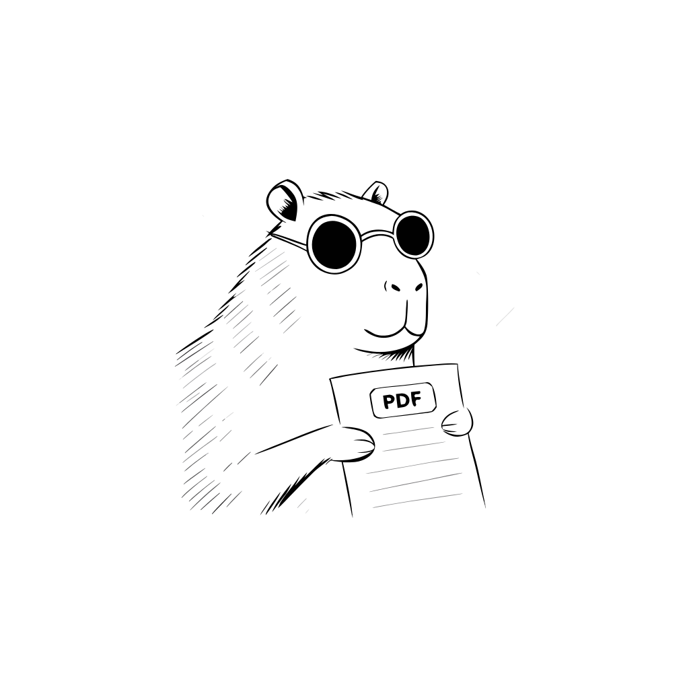

<h1 align="center">Capivara</h1>

<b>Ferramentas de PDF e conferência de plantas e memoriais descritivos de imóveis</b> 
Programa para Windows, em português, que funciona sem internet.

<a href="https://github.com/gab-silvaa/capivara-instalador/releases/latest"><b>⬇ Baixar o instalador (versão mais recente)</b></a>

---

## Instalar

1. Baixe `Capivara-X.Y.Z-instalador.exe` na [página de versões](https://github.com/gab-silvaa/capivara-instalador/releases/latest).
2. Dê dois cliques no arquivo baixado. **Não pede administrador**: instala na conta do usuário, cria o atalho no
   menu Iniciar (e, se quiser, na Área de Trabalho) e a opção **"Abrir no Capivara"** ao clicar com o botão direito
   num PDF.
3. Se o Windows mostrar *"O Windows protegeu o computador"* (SmartScreen), clique em **Mais informações** →
   **Executar assim mesmo**. O aviso aparece porque o instalador não tem assinatura de código comprada; não é vírus.

**Para atualizar**, basta rodar o instalador da versão nova; as configurações são mantidas.

Requisitos: Windows 10 ou 11 (64 bits). Para converter Word → PDF, o Microsoft Word instalado.

> O arquivo original **nunca é alterado**: o resultado de qualquer ferramenta sai sempre numa cópia.

---

## Ferramentas

### PDF

| Ferramenta | O que faz |
|---|---|
| **OCR e compressão** | Deixa o PDF pesquisável (Ctrl+F), reduz o tamanho e gera PDF/A. Aceita PDFs e imagens; arraste arquivos ou pastas. Detecta sozinho os PDFs que já têm texto. |
| **Editar PDF** | Editar texto existente (com a fonte, o negrito e a cor do original), escrever, marca-texto, retângulo, desenho à mão, imagem ou assinatura escaneada. *Apagar* e *Tarja preta* removem o conteúdo de verdade do arquivo. |
| **Organizar PDF** | Juntar PDFs e imagens, mudar a ordem das páginas arrastando, girar, excluir e dividir. |
| **Converter e PDF/A** | PDF/A sem OCR; Word ou imagem → PDF; PDF → Word (o escaneado vira Word com o texto reconhecido); PDF → imagem (PNG, JPG, TIFF). |
| **Marca d'água e numeração** | Marca de texto em diagonal ou de imagem (logo, brasão, selo), clara, média, forte ou sem transparência; carimbo num quadro ("CONFERE COM O ORIGINAL"); numeração "Página 1 de 12", "Fls. 1"… Prévia em que dá para arrastar a marca e o carimbo. |
| **Senha** | Proteger com senha (AES-256), para abrir ou só para imprimir/copiar/editar; remover a senha de quem a sabe. |
| **Assinar PDF** | Assinatura digital com certificado **A1** (arquivo .pfx) ou **A3** (token/cartão, pelo Windows), no padrão PAdES. |
| **Reparar PDF** | Recupera PDFs danificados que não abrem ou abrem com erro: reconstrói a estrutura, reescreve o arquivo e, em último caso, salva as páginas que ainda se leem. |

### Conferência

| Ferramenta | O que faz |
|---|---|
| **Verificar assinatura** | Quem assinou, se é ICP-Brasil (qualificada) ou gov.br, se o documento foi alterado depois da assinatura, revogação do certificado, hash do arquivo; relatório em PDF. |
| **Comparar** | Mostra lado a lado o que mudou entre dois documentos (PDF, inclusive escaneado, Word, RTF ou texto), palavra por palavra. |
| **Procurar em PDFs** | Busca uma palavra, nome, CPF ou matrícula dentro de todos os PDFs de uma pasta. |
| **Ler em voz alta** | Lê PDF (inclusive escaneado), Word ou texto, destacando a frase lida: bom para conferir matrícula × título de ouvido. Vozes do Windows (sem internet) ou vozes neurais online. |

### Imóveis — Planta ⇄ memorial

- **Escrever o memorial a partir da planta**: DWG, DXF ou PDF do CAD; um imóvel ou loteamento inteiro; texto em
  Word ou PDF.
- **Desenhar a planta a partir do memorial**: Word, PDF (até escaneado) ou o texto colado. Entende coordenadas UTM,
  azimutes, rumos (inclusive "SE 66º30'"), deflexões, curvas, frente/lados/fundo, memoriais do SIGEF/INCRA e
  descrições com trechos pela margem de rio.
- **Conferir planta × memorial**: lado a lado, com cada medida, ângulo, coordenada, área e confrontante; loteamento
  lote a lote; planta em PDF do CAD lida pela **tabela de azimutes e distâncias** (várias tabelas por folha, faixa
  de servidão dentro da gleba, coordenadas escritas no desenho conferidas).
- **Diagnósticos**: vértice com coordenada digitada errada no memorial georreferenciado (com a coordenada provável e
  o padrão do erro, conferido pela área), distância ou azimute digitado errado, matrícula de outro cartório,
  descrição que admite mais de uma forma ("Forma indefinida", com exemplos e a faixa de cada ângulo).
- **Planta de retificação**: confrontantes e anuências da tabela, cruzados com as assinaturas digitais do PDF;
  **relatório de retificação** em PDF.
- **Só o exato**: medida ou ângulo que o documento não dá nunca é inventado. O que não é exato aparece marcado e não
  sai em DXF, PDF da planta nem no memorial gerado.

---

## Privacidade

O Capivara roda **no seu computador**. Os documentos não são enviados para lugar nenhum, com duas exceções que
dependem de você:
- as **vozes neurais online** do *Ler em voz alta* enviam o texto lido para o serviço de voz da Microsoft (as vozes
  do Windows funcionam sem internet);
- o **Verificar assinatura** consulta, pela internet, a lista de certificados revogados da autoridade certificadora.

---

## Componentes de terceiros

O instalador inclui estes programas, cada um com a sua licença; o código-fonte de cada um está nos endereços abaixo.

| Componente | Uso | Licença | Código-fonte |
|---|---|---|---|
| Ghostscript 10.07.0 | OCR, compressão e PDF/A | AGPL-3.0 | <https://github.com/ArtifexSoftware/ghostpdl> |
| Tesseract 5.5.0 | reconhecimento de texto (OCR) | Apache-2.0 | <https://github.com/tesseract-ocr/tesseract> |
| LibreDWG | ler arquivos DWG | GPL-3.0 | <https://github.com/LibreDWG/libredwg> |
| PROJ e grades do IBGE | conversão de datum (SAD69, Córrego Alegre → SIRGAS 2000) | MIT | <https://github.com/OSGeo/PROJ> |
| PyMuPDF | ler, desenhar e editar PDF | AGPL-3.0 | <https://github.com/pymupdf/PyMuPDF> |
| OCRmyPDF, pikepdf, pyHanko, ezdxf, Shapely, customtkinter e outras bibliotecas Python | — | as de cada projeto | no PyPI de cada uma |

---

## Versões

As novidades de cada versão estão na [página de versões](https://github.com/gab-silvaa/capivara-instalador/releases).
